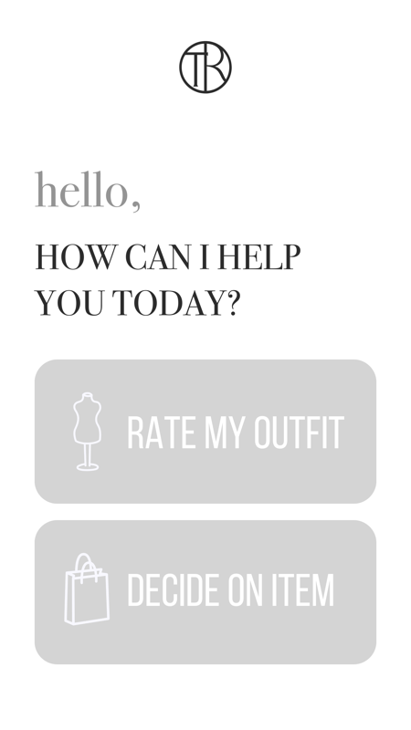
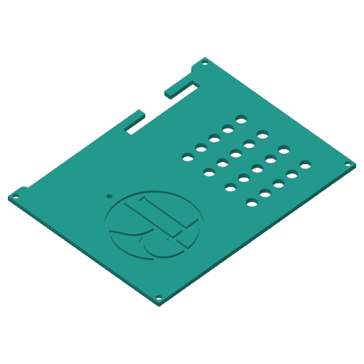
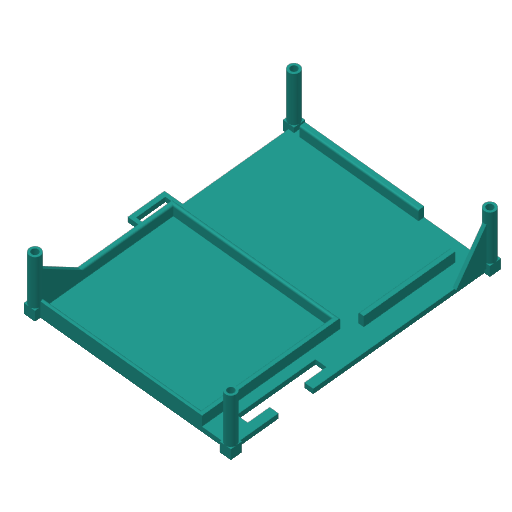
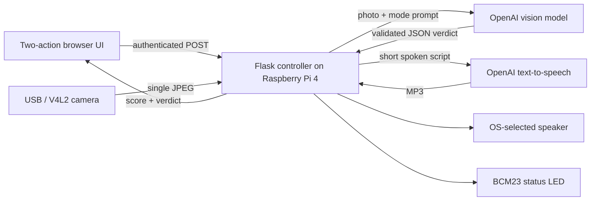

# Tailored Smart Mirror

A Christmas 2025 buildathon prototype: press **Rate my outfit** or **Decide on item**, capture a photo with a Raspberry Pi, and hear a short styling verdict. Built to connect a physical camera, a simple web interface and AI feedback in one tangible interaction.

<p>
  
  
  
</p>

**Interface artwork and enclosure CAD renders.** A physical build demo is being prepared; see [Demo](docs/Demo.md).

## How it works



The two modes share a review schema so the UI and spoken feedback stay consistent. The LED flashes during capture, blinks during analysis and returns to steady on afterward. OpenCV takes a single frame rather than running a continuous camera stream; pygame plays speech through the operating system's selected speaker. Editable enclosure designs accompany the software.

## Project status

The prototype was developed during the Christmas 2025 buildathon, with enclosure designs added in January 2026. Automated tests use simulated hardware and provider responses; the current revision still needs an end-to-end check on the physical Pi with a live AI account.

The app uses a USB/V4L2 camera and an OS-selected speaker. CSI cameras, microphone input, streaming and multi-user operation are not supported. Styling scores are subjective AI feedback. Photos are sent to OpenAI, and requests require internet access and an account with access to the configured models.

## Run it

Use a Raspberry Pi 4, USB/V4L2 camera, speaker, status LED with resistor, suitable power supply and network access. Follow [Pi setup](SETUP_RASPBERRY_PI.md) and [wiring](docs/Wiring.md). The setup guide targets 64-bit Raspberry Pi OS Trixie with Python 3.13; automated checks cover Python 3.12 and 3.13.

```bash
python3 -m venv --system-site-packages .venv
source .venv/bin/activate
python -m pip install -r requirements-hardware.lock
mkdir -p secrets
cp .env.example secrets/.env
# Edit secrets/.env with your own API key.
GPIOZERO_PIN_FACTORY=lgpio python src/main.py
```

Open `http://127.0.0.1:8080` on the Pi, or use the SSH tunnel in the setup guide. Each action captures and submits a photo, displays a verdict and plays AI-generated speech. The server binds loopback, disables the debugger and requires a per-run browser token for API routes. Inputs are deleted after each request; only the latest successful speech is kept in ignored `runtime/` until replacement or shutdown. Do not photograph anyone without consent.

For offline checks on Linux/Python 3.12:

```bash
python3 -m venv .venv
source .venv/bin/activate
python -m pip install -r requirements.lock
python -m unittest discover -s tests -p 'test_*.py' -v
```

## Source and credit

| Path | Responsibility |
| --- | --- |
| `src/main.py` | Small launcher: local configuration and orderly shutdown |
| `src/smart_mirror/app.py`, `routes.py` | Application factory, authenticated HTTP routes and security headers |
| `src/smart_mirror/config.py`, `controller.py` | Validated settings, serialized analysis and media/device lifecycle |
| `src/smart_mirror/provider.py`, `prompts.py`, `review.py` | AI calls, original styling instructions, review validation and spoken script |
| `src/smart_mirror/images.py`, `devices/` | Safe uploads, USB capture, LED and speaker |
| `src/templates/`, `src/static/` | Tailored HTML, separate CSS/JavaScript and original artwork |
| `tests/` | Synthetic regression tests and manual hardware checks |
| `BoM for 3D printed parts/` | Original STL, editable 3MF and logo SVG/DXF |

All supplied project assets belong to **Tailored LTD EOOD**. Original contributors are credited in Git history, and Alexander Stoilov’s original copyright is retained alongside company ownership. See [asset provenance and credits](docs/Attribution.md) and [LICENSE](LICENSE).
