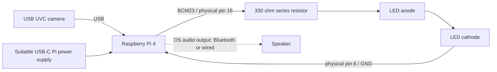

# Wiring

The diagram shows the GPIO23 LED circuit, USB camera, Pi power and audio connections used by the application. Check the LED circuit and suggested 330 Ω resistor against the physical build before applying power.

| Connection | Code evidence | Verification |
| --- | --- | --- |
| LED BCM23 → pin 16 | `src/main.py` default and `tests/scripts/led_test.py` | Pin mapping documented; actual connection unverified |
| LED series resistor → LED → ground | Standard current-limited indicator circuit | Suggested 330 Ω; original part/value unverified |
| USB camera → USB port | OpenCV `VideoCapture(index, CAP_V4L2)` | UVC device/model/index need testing |
| Pi → speaker | pygame mixer; historical Bluetooth test | OS must select/route audio; actual speaker unverified |

GPIO signals are 3.3 V. Use a series resistor and a small indicator LED, never connect the LED directly between an output and ground or attach 5 V to a GPIO input. Power off before changing connections. `gpiozero` uses BCM numbering, not physical header numbers. On the Pi, run `pinout` (from the OS gpiozero package) to confirm header orientation and numbering. Official [Raspberry Pi hardware documentation](https://www.raspberrypi.com/documentation/computers/raspberry-pi.html) describes the header and GPIO constraints.

The STL/3MF files describe the enclosure plates. Select print material and tolerances to suit the assembly, and allow for mounting and cooling. The application uses a USB camera; touchscreen, microphone and CSI camera integration are not implemented.
